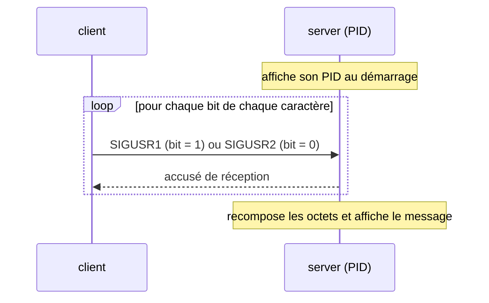

# Minitalk

**Communication entre deux processus via les signaux UNIX.** Un client transmet
une chaîne à un serveur **bit par bit**, en n'utilisant que `SIGUSR1` et
`SIGUSR2` — aucune socket, aucun fichier partagé. Projet du tronc commun de
l'École 42.


## Principe



Chaque caractère est envoyé bit par bit ; le serveur reconstruit les octets et,
au caractère nul, affiche le message complet. Le serveur accuse réception de
chaque bit pour fiabiliser la transmission.

## Build & lancement

```bash
make                       # compile -> ./server et ./client
./server                   # affiche son PID, ex. 4242
./client 4242 "Hello 42!"  # envoie le message au serveur
```

## Structure

```
server.c        boucle de réception, reconstruction des octets
server_utils.c  handlers de signaux
client.c        découpe le message en bits et les émet
```

Compilé avec `-Wall -Wextra -Werror` (norme 42).

## Licence

MIT — voir [LICENSE](LICENSE).
